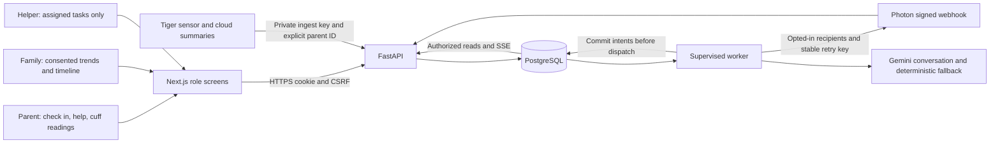

# FarCare architecture

This release is an invite-first care-coordination pilot. Production deployment and
actual provider delivery have separate acceptance gates in the
[runbook](production-runbook.md); passing tests do not establish clinical safety.

## Accounts and access

Individual accounts use salted scrypt password hashes, opaque expiring HttpOnly
sessions, persistent rate limits, and CSRF checks. Production requires Secure cookies
and explicit HTTPS origins; demo endpoints and legacy bearer authentication are off.
Public registration is off by default. [Pilot setup](pilot-setup.md) covers operator
provisioning/recovery; email verification and MFA are not claimed.

Invitations assign parent/helper roles server-side. Family-created parent profiles
start with health/check-in sharing off. Parents choose sharing and approve helpers,
including a separate safety-contact grant. The API checks linkage, consent, role and
current assignment. Client URLs and role controls cannot grant access.

Family SSE rechecks session and sharing for every batch. Logout/expiry terminates the
stream; new private events are excluded after consent changes. Parent/helper screens
poll while open. Connection status does not establish sensor freshness or phone delivery.

## Care transitions and durable processing

Routine help follows created → awaiting approval → approved → sent → accepted → completed.
Decline/timeout proposes another eligible helper and clears the prior ordinary approval.
Safety events use deterministic code and approved emergency contacts. FarCare never
calls emergency services automatically. Helper data is limited to a first name and task
details, without private health readings or family conversation history.

API care mutations and worker units share a PostgreSQL transaction mutex. The worker
processes committed inbound messages, timers and outbox jobs in a separate supervised
process. Successful-cycle timestamps drive readiness and visible stale/offline states.

Outbound jobs retain immutable recipient/body snapshots and stable provider retry keys.
Dispatch rechecks current account, consent, membership and assignment; revoked/changed
grants cancel pending jobs. Unversioned family AI history is excluded so an old grant
cannot silently survive in a later model prompt.

Available means an in-app task/state can be read by the account. Queued means a durable
intent exists. Accepted means Photon accepted submission. None proves delivery, reading,
or human response. Account-only helpers work in their task view; phone messages require
real Photon opt-in/routing. Console messaging is explicitly simulated.

## Health and learning

Tiger ingestion preserves source dates, missingness and live/simulated labels for steps,
reported resting heart rate and main sleep. Per-parent source binding is explicit; a new
account never inherits another person's sensor stream. Manual cuff BP has its own source
and is never inferred from Fitbit.

Personal references are append-only provisional statements. Seven qualified completed
local dates within 28 support descriptive median/MAD learning; this engineering coverage
rule is not clinical calibration. A qualified current reading can be compared without
reusing a training date. Simulated, acute, invalid or mixed-stream data cannot establish a
real baseline. Symptom/BP guidance runs separately and cannot be overridden by a stated
reference. [Sources, exclusions and exact rules](health-evidence.md).

## Storage, verification and deployment

Existing care, sensor and timeline tables remain. Additive tables hold accounts, sessions,
rate limits, invitations, ownership, cuff readings, references, action receipts, audit events,
worker coordination and durable jobs. create_all creates missing tables; it does not alter
existing ones. The deployment directory includes a migration for earlier runtime previews.

Pydantic contracts live in schemas/contracts.py and schemas/experience.py. OpenAPI and
TypeScript are generated and checked for drift. CI runs SQLite/PostgreSQL tests, API-image
startup, frontend checks/build, a three-role browser workflow with synthetic records, and
secret scanning. See [frontend roles](frontend-roles.md) and [API contracts](api-contracts.md).

The prepared deployment uses Next, API, worker, PostgreSQL and a /backend gateway. Only a
loopback upstream port is published; an operator configures HTTPS and secrets. No host,
domain, provider line or paid resource is created by the templates. Clinical review, live
delivery/failure handling, monitoring and backup restoration remain acceptance work.
